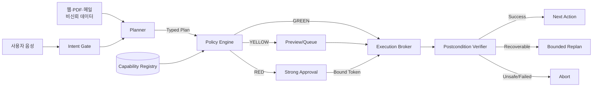
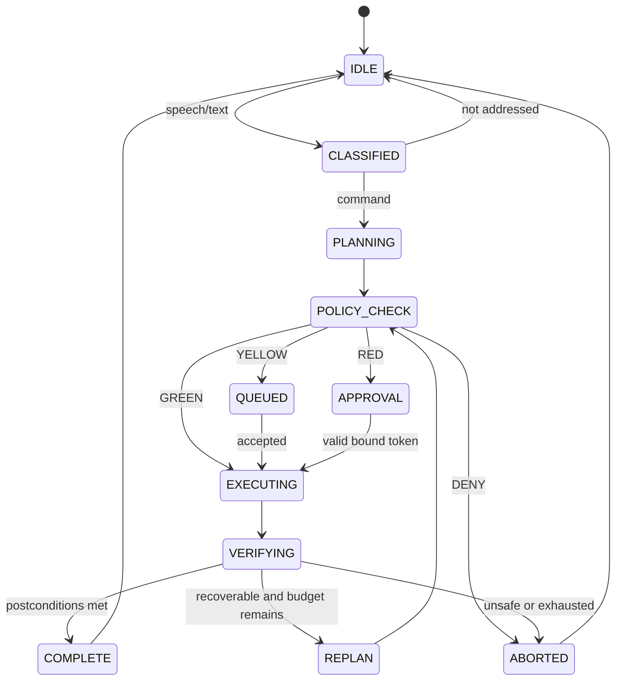

# JAVIS-PC 안전 실행 아키텍처

## 신뢰 경계



Planner 출력과 화면·문서 내용은 신뢰하지 않는다. capability registry, policy engine, approval verifier와 로컬 STOP 경로만 실행 권한을 통제한다. LLM은 registry를 수정하거나 승인 토큰을 만들 수 없다.

## 데이터 흐름

1. typed classifier가 evidence를 제안하고 Intent Gate가 addressedness, command intent,
   target confidence의 최솟값으로 route를 결정한다. exact STOP과 untrusted content는 모델을 우회한다.
2. Planner는 등록된 capability ID와 argument choice만 참조하는 `Plan`을 제안하며 사용자 goal은
   모델 출력이 아니라 원래 입력에 다시 결합된다.
3. 스키마 검증 실패 또는 unknown capability는 deny한다.
4. Policy Engine은 capability risk floor와 현재 문맥을 합성한다.
5. GREEN은 즉시 실행 후보, YELLOW는 preview/queue, RED는 강한 승인 대상으로 보낸다.
6. Execution Broker는 action 직전에 정책과 승인을 다시 검사한다.
7. Verifier는 각 postcondition을 실제 상태에서 평가한다.
8. 실패는 제한된 retry/replan 또는 abort로만 전이한다.

## 정책 순서

정책은 다음 순서로 평가한다.

```text
schema valid?
  -> capability registered?
  -> prompt injection suspected?
  -> runtime target == planned target?
  -> min(addressed, intent, target) confidence
  -> capability risk floor
  -> requested risk (상향만 가능)
  -> privilege/external/sensitive context elevation
  -> GREEN/YELLOW/RED/DENY
```

R0·R1은 GREEN, R2는 YELLOW, R3·R4는 RED다. R4는 강한 로컬 인증이 필요하다. DENY는 승인 대상이 아니며 새 계획이나 사용자 입력 없이는 실행으로 전이할 수 없다.

## 승인 수명주기

승인 토큰에는 `task_id`, `action_id`, `capability_id`, `arguments_hash`, `target_identity`, `risk`, `issued_at`, `expires_at`, `nonce`를 포함한다. HMAC 서명을 확인한 뒤 현재 action과 모든 필드를 정확히 비교한다. 기본 TTL은 120초이고 검증 성공 시 nonce를 소비한다. 대상·인자·위험도 변경, 만료, 재사용은 모두 거부한다.

Phase 0의 HMAC 서비스는 단일 프로세스 연구용이다. 다중 프로세스 구현에서는 secret을 Windows Credential Manager 또는 DPAPI로 보호하고 nonce 저장소를 원자적으로 공유해야 한다.

## 실행 및 검증

executor 선택은 capability가 허용한 목록 안에서 Native API → 제한된 PowerShell → UIA → Vision 순서를 따른다. raw shell 문자열을 Planner가 직접 제공하는 인터페이스는 만들지 않는다. 각 adapter는 구조화된 결과만 반환한다.

Windows 앱 실행은 등록 경로를 이름으로 다시 여는 짧은 TOCTOU를 줄이기 위해 deny-write/delete
공유 mode의 read handle을 획득한다. final path와 SHA-256을 handle에서 확인하고 process launch가
반환될 때까지 handle을 유지한다. 이 lease는 standard sharing semantics를 따르는 교체를 막지만
관리자·kernel 수준 변경을 완전히 차단하는 보안 경계는 아니다.

Verifier predicate는 별도 registry로 관리하고 파일 존재·해시, 프로세스·창 존재, UIA 속성 같은 실제 상태를 읽는다. 기본 재시도는 동일 adapter 1회, 대체 adapter 1회, replan 1회로 제한한다. RED action은 replan으로 대상이나 인자가 바뀌면 반드시 새 승인을 받는다.

## 상태 머신



## 로그와 개인정보

감사 로그는 task/action/policy/result correlation ID, capability, 위험도, 정책 이유, executor 종류, 검증 결과와 지연시간만 기본 저장한다. API 키, 승인 토큰, 비밀번호, 원문 음성, 전체 화면은 저장하지 않는다. 인자는 capability별 redaction rule을 적용하고 screenshot은 명시적 디버그 모드가 아니면 휘발 처리한다.

로컬 승인 창은 실행 직전 capability, 목적, 대상, 위험도와 정확한 인자를 보여 준다. 창 닫기와
시간 초과는 거부다. R4 인증은 애플리케이션이 PIN이나 비밀번호를 받지 않고 Windows가 소유한
인증 UI 결과만 전달받는 adapter를 사용한다. desktop 연동은 HWND 기반
`UserConsentVerifierInterop.RequestVerificationForWindowAsync`를 사용해야 하며 provider가
없으면 실행하지 않는다. native helper는 자체 표시 창의 HWND만 전달하고, one-time challenge와
SHA-256 manifest로 Python IPC에 결합된다. 참고:
https://learn.microsoft.com/en-us/windows/apps/develop/ui/display-ui-objects

## Phase 0 완료 조건

- unknown capability가 항상 DENY/R4다.
- R0 capability가 문맥 때문에 R3 이상으로 상향될 수 있다.
- R4는 RED이며 strong auth가 필요하다.
- 낮은 addressedness 또는 target mismatch가 실행을 차단한다.
- 승인 토큰이 인자·대상·위험도·만료·재사용 변조를 거부한다.
- 저장소에 NIM/API 키가 추적되지 않는다.
- 단위 테스트가 실제 Windows 부작용 없이 통과한다.
